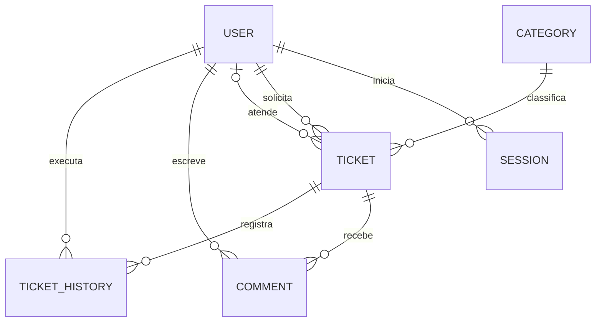
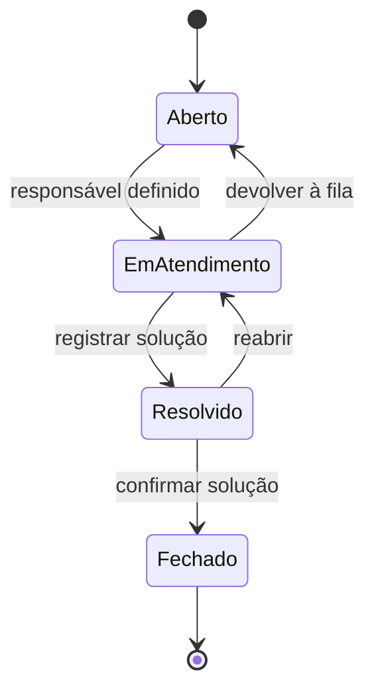

# Arquitetura do HelpDesk Pro

## Caminho de uma requisição

O navegador usa o Next.js e envia requisições de API à mesma origem. O Next.js encaminha `/api/*` para o NestJS. O backend valida entradas com DTOs, autentica a sessão, aplica as regras e acessa PostgreSQL pelo Prisma. O Prisma 7 usa `prisma.config.ts` para a URL da CLI e o adaptador `@prisma/adapter-pg` em execução.

## Modelo de dados

A migration original do starter foi preservada. A segunda migration adiciona os campos de solução, SLA, versão e estado de conta. Ela calcula o prazo dos chamados antigos ainda pendentes. Chamados antigos já resolvidos podem ter solução e prazo ausentes, pois esses dados não existiam no modelo anterior.

## Visibilidade e fluxo

| Perfil | Chamados visíveis | Ações |
| --- | --- | --- |
| Solicitante | Próprios chamados | Abrir, comentar e confirmar ou reabrir os próprios chamados resolvidos |
| Técnico | Fila sem responsável, seus atendimentos e chamados que abriu | Assumir chamados livres, atualizar seus atendimentos e comentar no escopo visível |
| Administrador | Todos | Atribuir, alterar prioridades e status, comentar e gerenciar contas |

Ao devolver um chamado em atendimento para **Aberto**, o responsável é removido e a ocorrência volta à fila da equipe. Chamados antigos resolvidos que não têm responsável voltam a **Aberto** quando reabertos. O fechamento encerra o chamado e impede novos comentários. A reabertura limpa a solução atual e preserva o texto anterior no histórico. A API retorna as ações permitidas junto ao detalhe.

## SLA e concorrência

| Prioridade | Prazo de resolução |
| --- | --- |
| Crítica | 4 horas |
| Alta | 12 horas |
| Média | 24 horas |
| Baixa | 72 horas |

O SLA conta horas corridas desde a abertura. Mudar a prioridade recalcula o prazo a partir da data original. Reabrir mantém o prazo. Os indicadores de atraso consideram chamados pendentes com prazo anterior ao momento da consulta.

Alterações usam transação e um contador de versão. Se dois atendimentos tentarem editar o mesmo estado, uma gravação baseada na versão anterior recebe HTTP 409. A atualização do chamado e o histórico correspondente são confirmados juntos. O detalhe exibe até 50 comentários e 50 eventos recentes.

## API

Todos os caminhos abaixo recebem o prefixo `/api`.

| Método e rota | Uso |
| --- | --- |
| `GET /health` | Verifica conexão com o banco |
| `POST /auth/login` | Valida credenciais e cria sessão |
| `GET /auth/me` | Retorna a conta da sessão |
| `POST /auth/logout` | Revoga a sessão e limpa o cookie |
| `GET /categories` | Lista categorias |
| `GET /tickets` | Aceita `search`, `status`, `priority`, `categoryId` e `page` |
| `GET /tickets/overview` | Contadores agregados por escopo |
| `POST /tickets` | Recebe `title`, `description`, `categoryId` e `priority` opcional |
| `GET /tickets/:id` | Detalhe, solução, comentários, histórico e ações permitidas |
| `PATCH /tickets/:id/assignee` | Recebe `assigneeId` ou `null` |
| `PATCH /tickets/:id/priority` | Recebe `priority` |
| `PATCH /tickets/:id/status` | Recebe `status` e exige `resolution` para resolver |
| `POST /tickets/:id/comments` | Recebe `content` |
| `GET /users` | Administração, com `search` e `page` |
| `GET /users/technicians` | Equipe ativa disponível para atribuição |
| `POST /users` | Cadastro com `name`, `email`, `password` e `role` |
| `PATCH /users/:id/active` | Ativa ou desativa com `active` booleano |

## Segurança e escopo

- Senhas usam bcrypt. Tokens de sessão usam 256 bits aleatórios e o PostgreSQL guarda o hash SHA-256. O cookie usa HttpOnly e SameSite=Lax, com Secure obrigatório em produção.
- Sessões expiram em sete dias. Logout e desativação revogam sessões no servidor. A API consulta o estado ativo da conta nas rotas protegidas.
- Operações de escrita exigem `Origin` correspondente a `WEB_ORIGIN`. Produção exige uma origem HTTPS. A API fica atrás do proxy na configuração Docker e o Swagger só abre em desenvolvimento.
- A limitação de login local usa o IP do socket. Atrás do proxy, os clientes podem compartilhar a mesma cota. Para hospedagem pública, configure limitação por cliente no proxy confiável e uma política de expiração e limpeza de sessões no banco.
- O escopo desta versão contempla o fluxo interno de atendimento. Anexos, notificações, recuperação de senha, exportação e base de conhecimento ficam fora do escopo.
